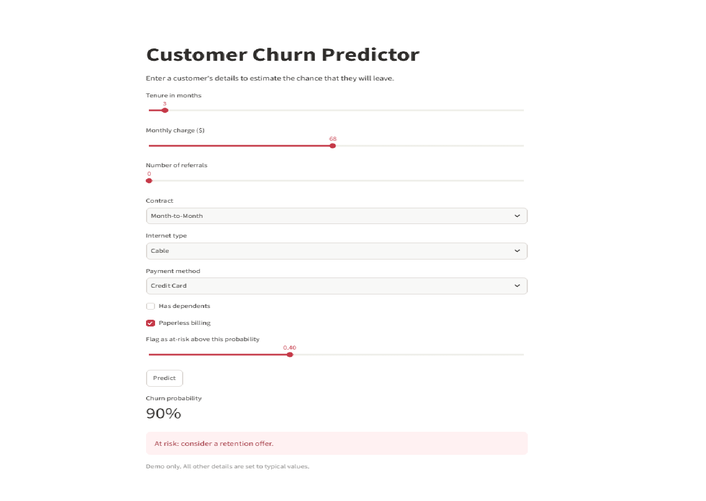
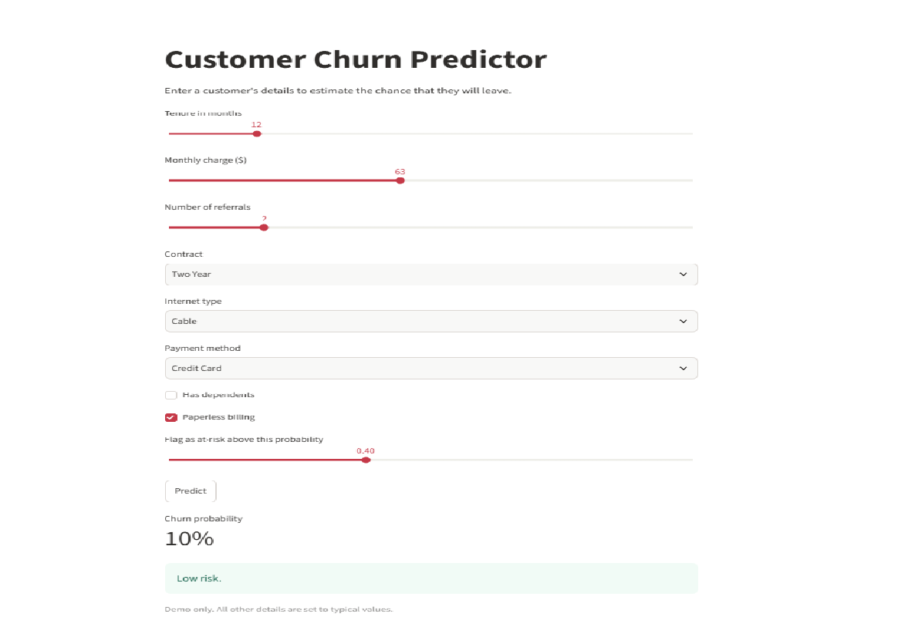

# Customer Churn Prediction

Predicts which telecom customers are likely to leave, explains why, and estimates the business value of a targeted retention campaign. Includes a Streamlit app for single-customer predictions.

## Problem

Keeping a customer is cheaper than winning a new one. The goal is to find customers at risk of churning early enough to offer them something, and to understand what drives churn.

## Data

IBM Telco Customer Churn sample data from [Kaggle](https://www.kaggle.com/datasets/alfathterry/telco-customer-churn-11-1-3): 7,043 customers and 50 columns, about 26% of whom churned. This is a sample dataset from a fictional company, so results show the method, not real-world performance.

## Approach

1. **Cleaning:** removed 13 columns, leaving 37. Leakage columns that reveal the outcome (Churn Reason, Churn Category, Churn Score, Satisfaction Score, CLTV, Customer Status), identifiers and constant fields, and columns that repeat other information (Total Revenue, Total Charges, Total Long Distance Charges, Referred a Friend).
2. **Preparation:** filled blanks that meant "none", one-hot encoded categories, stratified 80/20 train-test split, scaling fitted on training data only.
3. **Models:** Logistic Regression (explainable baseline) and Random Forest, both with balanced class weights.
4. **Evaluation:** recall, precision, ROC-AUC, confusion matrices and 5-fold cross-validation.
5. **Explanation:** odds ratios (Logistic Regression) and feature importance (Random Forest).
6. **Business layer:** cost-based threshold selection and estimated net benefit.

## Results

| Metric | Logistic Regression | Random Forest |
|---|---|---|
| ROC-AUC (test) | 0.906 | 0.903 |
| ROC-AUC (5-fold CV) | 0.895 | 0.889 |
| Churner recall (cutoff 0.5) | 0.87 | 0.57 |
| Churner precision (cutoff 0.5) | 0.59 | 0.75 |
| Accuracy | 0.80 | 0.84 |

Both models rank customers about equally well. Logistic Regression catches far more churners at the default cutoff and is explainable, so it is the recommended model. Accuracy alone is misleading here because about 74% of customers stay.

## Key findings

- **Raise churn risk:** short tenure, month-to-month contracts, no referrals.
- **Lower churn risk:** two-year and one-year contracts, referrals, having dependents, longer tenure.
- Some odds ratios (for example Monthly Charge and Married) are unreliable because the features overlap with others, so only the robust ones are reported.

## Business impact

Assumptions: $50 per retention offer, 30% of flagged churners saved, 12 months of revenue protected. These are assumptions, not measured values.

On the 1,409 test customers, a cutoff of 0.4 gives the best net benefit, about $59,800. Offering a discount to every customer gives about $29,800, so targeting roughly doubles the benefit under these assumptions.

## App

The Streamlit app takes a few customer details and returns a churn probability. All other details are set to typical values, so it is a demo.




## Run it locally

```
pip install -r requirements.txt
streamlit run churn_app.py
```

Python 3.10 or newer is recommended.

## Files

| File | Purpose |
|---|---|
| `Customer_Churn.ipynb` | Full analysis notebook |
| `churn_app.py` | Streamlit app |
| `churn_model.pkl`, `scaler.pkl`, `columns.pkl`, `defaults.pkl` | Saved model and preprocessing objects |
| `requirements.txt` | Python dependencies |

## Limitations and next steps

- Sample dataset, so real-world performance is unknown.
- No extensive hyperparameter tuning yet.
- The threshold was chosen on the test set. A validation set would be cleaner.
- Costs and save rate are assumptions to be replaced with real figures.
- The model predicts risk but does not prove cause. An A/B test would show whether offers work.
- Attributes such as Senior Citizen are in the model and deserve a fairness review.

## Tech stack

Python, pandas, scikit-learn, matplotlib, seaborn, Streamlit.
